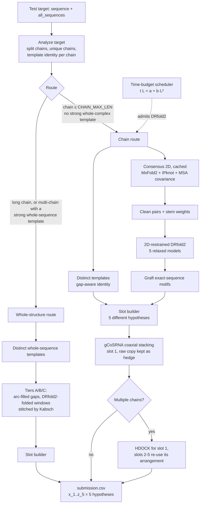

# RNA 3D Structure Prediction Pipeline

An end-to-end, **fully offline** pipeline for predicting the 3D structure of RNA targets (including multi-chain RNA complexes), built for the [Stanford RNA 3D Folding](https://www.kaggle.com/competitions/stanford-rna-3d-folding-2) Kaggle competition. It combines thermodynamic and deep-learning secondary-structure folders, MSA co-evolution signal, a 2D-restrained deep-learning 3D predictor, template/homology modelling, coaxial-stacking refinement and rigid-body docking, and it fills the five submission slots with **five different structural hypotheses** under an explicit **time-budget scheduler**. Every dependency is installed from pre-uploaded datasets or compiled inside the notebook (no internet at run time).

**Full run:** all 28 targets in 3.9 h on a Kaggle GPU (8 h limit). **Leaderboard result:** public 0.30172, private 0.38491.

### Results

| Version | Public | Private | Full-run time |
|---|---|---|---|
| Earlier pipeline (one structure repeated in all five slots, binary 2D gate, fixed length threshold) | 0.27193 | 0.35099 | 5 h 42 m |
| This pipeline | 0.30172 | 0.38491 | 3 h 52 m |

Both scores moved in the same direction (+0.030 public, +0.034 private), but the changes were evaluated together in a single run, so the table does not attribute the gain to individual components.

---

## Table of Contents

- [Why this is hard](#why-this-is-hard)
- [Pipeline at a glance](#pipeline-at-a-glance)
- [Stage-by-stage walkthrough](#stage-by-stage-walkthrough)
  - [1. Data preparation](#1-data-preparation)
  - [2. Secondary structure (2D) and consensus](#2-secondary-structure-2d-and-consensus)
  - [3. 2D-restrained DRfold2](#3-2d-restrained-drfold2)
  - [4. Template / homology candidates](#4-template--homology-candidates)
  - [5. Long targets: tiered template completion](#5-long-targets-tiered-template-completion)
  - [6. Slot builder: five different hypotheses](#6-slot-builder-five-different-hypotheses)
  - [7. Coaxial-stacking refinement (gCoSRNA)](#7-coaxial-stacking-refinement-gcosrna)
  - [8. Multi-chain assembly](#8-multi-chain-assembly)
  - [9. Submission formatting](#9-submission-formatting)
- [Time-budget scheduler](#time-budget-scheduler)
- [Orchestration logic](#orchestration-logic)
- [Configuration reference](#configuration-reference)
- [Offline / Kaggle engineering notes](#offline--kaggle-engineering-notes)
- [Design decisions and problems solved](#design-decisions-and-problems-solved)
- [Known limitations](#known-limitations)
- [Components & credits](#components--credits)

---

## Why this is hard

RNA tertiary structure prediction is an open problem: training data is scarce compared with proteins, base pairing is hierarchical (pseudoknots, long-range tertiary contacts), and a single target can contain several chains. The competition scores **TM-score on C1′ atoms, best of five submitted models, averaged over targets**, after a global superposition. Two consequences shape this design:

1. **Best-of-5 rewards diversity.** Five copies of one structure is the worst use of the five slots. Each slot should be a distinct, plausible hypothesis.
2. **Compute is a hard constraint.** The notebook has an 8-hour limit that includes environment setup, and DRfold2 cost grows roughly with the square of the chain length. Deciding *where* to spend GPU time matters as much as the models themselves.

The environment is also **air-gapped**: the toolchain is rebuilt from offline wheels, `.deb` files, and C/C++ sources.

---

## Pipeline at a glance



---

## Stage-by-stage walkthrough

### 1. Data preparation

Training sequences and C1′ coordinates are loaded from the merged label files. For every training entry a coordinate array of length `len(sequence)` is built, with **NaN rows for residues that have no coordinate** (including “missing” sentinel values such as −1e18) and with the residue-index base detected automatically (0- or 1-based). Keeping arrays aligned to the sequence guarantees that a template can be mapped by index without any residue shifting after a gap.

### 2. Secondary structure (2D) and consensus

- **MxFold2**: deep-learning plus thermodynamic folder, installed offline from a local wheel (poetry-core / poetry) and run with a pretrained config.
- **IPknot**: integer-programming folder that can recover **pseudoknots**. It is compiled from source inside the notebook (generated `CMakeLists.txt`, GLPK backend, ViennaRNA shared object and headers unpacked from a `.deb`).
- **MSA covariance**: mutual information with average-product correction (APC) is computed from the competition MSA. MSA files are stored per **entry** (`8WT9`), not per chain (`8WT9_F`), so a chain-suffixed id falls back to its entry file. The signal is only used when the MSA width equals the chain length (otherwise it is ignored), and sub-sequence window folds use no MSA.

`get_consensus_ss` takes a position where MxFold2 and IPknot agree; where they disagree, the pairing whose partner has the larger co-evolution score (above a threshold) wins, otherwise the position is left unpaired. The result is **cached per (sequence, target)**, so MxFold2, IPknot and the O(L²) covariance loop run once per sequence no matter how many stages consume the 2D structure.

The consensus dot-bracket is then converted to a list of pairs:

- all bracket types (`()`, `[]`, `{}`, `<>`) are parsed, so IPknot pseudoknots are kept;
- pairs are kept only if they are canonical (AU, GC, GU) and enclose at least 3 nucleotides;
- each pair is annotated with the **length of the stem** it belongs to, which is later used as a confidence weight.

A **continuous 2D-agreement score** in [0, 1] measures how well a 3D model honours the consensus: each pair contributes a Gaussian of its C1′–C1′ distance around 10.5 Å (σ = 2 Å), weighted by stem length. This score ranks models; it replaces a binary accept/reject gate.

### 3. 2D-restrained DRfold2

DRfold2 is the primary RNA 3D predictor: a deep network predicts distance distributions (distograms) for P–P, C4′–C4′ and glycosidic N–N pairs plus orientation terms, and a potential-based optimizer (`PotentialFold`: cubic-spline distance potentials, FAPE-style terms, L-BFGS) folds the structure; Arena then relaxes it to an all-atom model. The repo and weights are staged into the working directory and its scripts are patched at run time.

**Using the consensus 2D inside the folding.** Before the splines are fitted, a base-pair prior is *mixed* into the C4′–C4′ and N–N distograms of every consensus pair:

```
new = (1 - w) · predicted + w · prior
```

- `prior` is a Gaussian over the distance bins at the Watson–Crick distance; probability mass is moved out of the “far” bin as well, so the pair is not masked out as unconfident;
- `w` is `PAIR_PRIOR_W` for stems of three or more pairs, half of that for two-pair stems, and zero for lone pairs. In the final configuration `PAIR_PRIOR_W = 0`: a validation A/B (restrained vs free models inside the same DRfold2 run, TM-score against known structures) showed a best gain of only +0.006 TM, below the +0.02 bar, so the prior is off and all five models are unrestrained. The mechanism stays in the code and can be re-enabled;
- mixing rather than multiplying means a wrong consensus pair bends the model instead of breaking it;
- the pair list and prior parameters reach the optimizer through a small JSON file and environment variables, and the bin layout is checked before the prior is applied.

**Five relaxed models, all used.** DRfold2 is run with clustering enabled, which produces up to five relaxed models per sequence (the main model plus up to four cluster models; very short RNAs often yield only one or two). All returned models are read back. When the prior is enabled, models **2 and 4 are optimized without it** (`UNRESTRAINED_MODELS`), so the pool contains both restrained and unrestrained hypotheses.

Every model is measured for the median and IQR of the C4′–C4′ and N–N distance over confident stem pairs. Across 19 well-formed targets the C4′–C4′ medians were 14.7–15.1 Å and N–N was 8.94 Å for every model, which is the geometry the prior is centred on (the all-atom relaxation step rebuilds paired bases with ideal geometry, so these distances cannot by themselves show whether the prior had an effect).

Runs execute in their own process group with a timeout derived from the time model; a hung run is killed together with its child processes. Only models containing NaNs are discarded. Models with a consecutive-C1′ step above 9 Å are kept but ranked last, because the competition metric compares coordinates residue by residue and does not penalise chain breaks. Models are ranked by 2D agreement in buckets of 0.05; within a bucket DRfold2's own model order is kept, so `model_1` stays first when agreement is saturated. Exact-sequence motifs from the training set are then grafted onto each model (see below).

### 4. Template / homology candidates

For a query, every training sequence of compatible length is scored with a global `PairwiseAligner`; the top candidates are aligned in full and their coordinates mapped onto the query, leaving **NaN where a residue has no template coordinate**.

- **Distinct templates.** Candidates are de-duplicated: a template whose mapped coordinates superpose on an already selected one within 2 Å RMSD is dropped. Up to five distinct templates are kept.
- **Gap-aware confidence.** The aligner uses cheap gaps, so an unrelated sequence can still align about two thirds of its residues by gapping around mismatches. Template confidence is therefore the number of identical residues inside **gapless alignment blocks of at least 8 columns**, divided by `max(len(query), len(template))`. Unrelated pairs score near zero; real homologs score high. The same number drives routing, slot ordering and the “skip DRfold2” decision.
- **Gaps and overhangs at C1′ spacing.** Unmapped residues are filled geometrically: an interior gap becomes a **circular arc of arc length (n+1)·5.8 Å** between its two anchors, bulging away from the centre of the structure so it does not clash; 5′/3′ overhangs become straight tails pointing radially outward. Consecutive C1′ atoms in RNA are about 5.5–6 Å apart.
- **Graft.** Training sequences of at least 15 nt that occur *exactly* inside the query are found once per sequence (cached, with a pre-sorted template list) and Kabsch-aligned into every candidate, so experimentally known motifs override predicted geometry.

### 5. Long targets: tiered template completion

Chains above `CHAIN_MAX_LEN` (and whole complexes with a strong template) are not folded by DRfold2 end to end; the template path is tiered by how much of the target the templates cover:

| Tier | Situation | Handling |
|---|---|---|
| **A** | Good template | One distinct template per slot; gaps arc-filled; exact motifs grafted. |
| **B** | Partial coverage | Runs of uncovered residues of at least 25 nt are folded by 2D-restrained DRfold2 in windows of at most 150 nt (+8 nt flank each side) and **stitched** by Kabsch-aligning the flank residues that already have coordinates. Windows are processed left to right, so a placed window anchors the next. |
| **C** | No template | The same windowed folding over the entire sequence; if time does not allow it, a straight placeholder. |

Window folding happens only for the first two template slots and only inside the **slack time** the scheduler reports, so it can never starve other targets.

### 6. Slot builder: five different hypotheses

Candidates from DRfold2 (ranked by 2D agreement) and from templates (ranked by confidence) are merged into the five submission slots. Two candidates count as duplicates, and the later one is skipped, when their mutual **TM-score is ≥ 0.90** (`DUP_TM`; chains up to 400 nt; longer chains use RMSD < 1 Å). TM-score is what the competition measures, so tiny RNAs keep near-identical variants (1 Å matters for them) while long chains drop models the metric cannot tell apart:

| Best template confidence | Slot order |
|---|---|
| ≥ 0.80 | template, DRfold2, template, DRfold2, DRfold2 |
| ≥ 0.50 | DRfold2, template, DRfold2, template, DRfold2 |
| otherwise | DRfold2 ×4, template |

When only one kind of candidate exists, the other slots are filled from it; if the pool is smaller than five, the best candidates are repeated (never all-zero placeholders). Extra templates below a minimum confidence are dropped; the best one is always kept.

### 7. Coaxial-stacking refinement (gCoSRNA)

Multibranch junctions often show **coaxial stacking**: two helices stack end to end. gCoSRNA parses the consensus 2D into pseudo two-way junctions, predicts which stems stack with a trained scikit-learn model, and resolves conflicts with a max-weight matching over the junction cycle. It is called **in-process**, and each predicted stack is mapped back to exact residue indices of both stems and the junction pivot. A geometry routine rotates the smaller nested arm about the junction so its axis becomes collinear with the reference helix (moving the whole subtended arm so the backbone is not torn), guarded by a steric-clash check and wrapped so it cannot crash a prediction.

It is applied to **slot 1 only**, and the unmodified version of slot 1 is kept in slot 5 as a hedge in case the adjustment hurts. It is skipped for chains longer than `CHAIN_MAX_LEN`.

**Two fixes to gCoSRNA itself.** The released `identify_loops` uses every *nested* stem as a branch of the closing stem. A child helix that contains a bulge or internal loop then creates a fake empty branch, which crashes later (`TypeError: unsupported operand type(s) for -: 'NoneType' and 'int'`) and also mis-classifies some internal loops as multibranch loops. The patched version keeps direct-child stems only. In addition the stems of a loop are kept in ascending order (the original iterated a `set()` while later code assumes positional order). On 379 random nested structures the original crashed on 221 and the patched version on none. The consensus is also reduced to a nested, canonical, lone-pair-free dot-bracket before it is passed in.

### 8. Multi-chain assembly

Targets are split into chains from `all_sequences`; RNA chains are predicted once per **unique sequence** (a homodimer costs one fold).

- **Slot 1** is assembled by iterative **HDOCK** rigid-body docking (`hdock` + `createpl`) of the slot-1 monomers, falling back to a fixed-offset layout if docking fails or the residue count does not match. Non-RNA partner chains do not change the RNA fold and are not required for scoring.
- **Slots 2–5** re-use slot 1's chain arrangement: each chain's k-th candidate is Kabsch-fitted onto the corresponding chain of slot 1, so five conformational hypotheses are produced with **no additional docking runs**.
- If a multi-chain target has a strong whole-sequence template (identity ≥ 0.5), the **whole-structure route** is used instead: the template's own chain arrangement is kept and no splitting or docking is done.

### 9. Submission formatting

For every target exactly `len(sequence)` rows are written, with IDs `{target_id}_{i}`, `resname = sequence[i]`, and the five slots in `x_1…z_5`. Any failure degrades to a valid straight-chain placeholder, so the file is always schema-correct.

---

## Time-budget scheduler

The 8-hour limit includes environment setup, and DRfold2 cost is dominated by an O(L²) spline construction repeated for five clusters. Instead of a fixed length threshold, DRfold2 admission is planned against the remaining time.

- **Cost model.** `t(L) = a + b·L²`, fitted by least squares on observed wall times and **refitted online** after every real run. Measured per-target wall times (including 2D prediction, grafting and coaxial refinement): 19 nt 180 s, 30 nt 190 s, 101 nt 408 s, 165 nt 1100 s, 214 nt 1731 s, 246 nt 2270 s; the fit is about 132 s + 0.037·L². The scheduler is seeded with measurements from earlier runs.
- **Cost unit.** Cost is summed over **unique chain sequences** plus a per-step docking allowance for multi-chain targets.
- **Replanning.** Before every target, the remaining DRfold2-eligible targets are admitted cheapest first while the planned cost stays within `PLAN_FRACTION` (90 %) of the remaining time minus a reserve for template-only targets. What remains is **slack**, which pays for window folding in the long-target tiers.
- **Clock.** The remaining time is measured from notebook start (so setup is included) minus a safety margin for writing the CSV.
- **Template-confidence override.** If a chain's best template has identity ≥ `TEMPLATE_SKIP_CONF`, DRfold2 is skipped at any length.
- **Protection.** Every DRfold2 call has a timeout, errors fall back to templates, and if the budget is exhausted the remaining targets receive placeholders.

At the end of a run the fitted `a`, `b` and the per-target wall times are printed, to be pasted back into the model as a better prior.

The full 28-target run took 3.9 h, leaving about 4 h of the limit unused.

---

## Orchestration logic

`run_main_loop` per target:

1. **Analyze**: split chains, find unique chains, look up template confidence, choose the route (`chain` or `whole`) and decide whether the target is DRfold2-eligible. A plan table is printed.
2. **Replan** against the remaining time and decide whether this target may use DRfold2.
3. **Predict** five hypotheses: chain route (per unique chain: optional restrained DRfold2 + templates → slot builder → coaxial refinement → assembly) or whole-structure route (distinct templates → tiers → slot builder).
4. **Write** the five-slot rows and free GPU memory.

> Tinker (AMBER99 refinement), SimRNA (coarse-grained relaxation) and Protenix (all-atom prediction for non-RNA partners) are integrated and staged but **disabled** in the final run: the scored `sequence` column contains RNA only, and the runtime budget is better spent on RNA modelling. Their build code is retained for experimentation.

---

## Configuration reference

| Name | Default | Meaning |
|---|---|---|
| `CHAIN_MAX_LEN` | 250 | Longest single chain DRfold2 may fold (largest cap whose predicted DRfold2 time fits a 5.5 h budget on the test set). Longer chains use the template tiers. |
| `TEMPLATE_SKIP_CONF` | 0.90 | Template identity above which DRfold2 is skipped. |
| `WHOLE_TEMPLATE_CONF` | 0.50 | Multi-chain targets use the template's own arrangement above this identity. |
| `HIGH_TEMPLATE_ID` / `MID_TEMPLATE_ID` | 0.80 / 0.50 | Thresholds that decide slot order. |
| `TPL_ALIGN` | (2.0, −1.0, −4.0, −0.5) | Aligner match, mismatch, gap open, gap extend. Stricter gaps than the original (−0.5, −0.1) won a leave-one-out comparison of template TM-scores. |
| `TEMPLATE_RANK_BY` | `"score"` | Rank templates by alignment score (`"ident"` ranks by gapless-block identity). |
| `DUP_TM` / `DUP_TM_MAX_L` | 0.90 / 400 | Slot de-duplication by mutual TM-score. |
| `MIN_TEMPLATE_CONF` | 0.15 | Extra templates below this are dropped. |
| `PAIR_PRIOR_W` | 0.0 (code default 0.35) | Strength of the base-pair prior; 0 disables it. Set to 0 after the validation A/B showed no gain. |
| `PAIR_PRIOR_CC` / `PAIR_PRIOR_NN` | (14.84, 0.6) / (8.94, 0.6) | Prior centre and width in Å, from measured geometry (only used when `PAIR_PRIOR_W > 0`). |
| `UNRESTRAINED_MODELS` | `"2,4"` | DRfold2 models optimized without the prior. |
| `C1_STEP` | 5.8 Å | Consecutive C1′ spacing used for gap filling. |
| `SEG_MIN` / `SEG_MAX_WIN` / `SEG_FLANK` | 25 / 150 / 8 | Long-target window folding. |
| `LONG_SEG_FOLD_SLOTS` | 2 | Template slots that receive window-folded gaps. |
| `PLAN_FRACTION`, `SAFETY_S`, `SETUP_OFFSET_S` | 0.90, 1200, 600 | Time budgeting. |
| `DOCK_S` | 90 s | Allowance per docking step. |
| `INTER_CHAIN_OFFSET`, `ENABLE_COMPLEX_DOCKING` | 60 Å, `True` | Multi-chain layout. |

### Run modes and tuning tools

One notebook, one switch (`RUN_MODE`), and one dictionary (`TUNED_OVERRIDES`) holding every tuned value:

| Mode | What it does | Cost |
|---|---|---|
| `tune` | Leave-one-out comparison of template aligners and ranking (CPU), `CHAIN_MAX_LEN` from the time budget (CPU), restrained-vs-free A/B of the 2D prior and model diversity (GPU), geometry centres from measured models. Prints a ready-to-paste `TUNED_OVERRIDES`. | about 1 h |
| `compare` | Folds training RNAs that *do* have templates (identity bins 0.5–0.7 and 0.7–0.9) with DRfold2 and compares template-only, DRfold2-only and mixed best-of-5 TM-scores, to decide when DRfold2 is worth running. | about 45 min GPU |
| `test` | A stratified subset (short DRfold2 targets spread over the length range, one multi-chain, one template-confident, one long target); writes `submission_test.csv` and prints a tuning summary. | about 45 min |
| `final` | All targets; writes `submission.csv`. | 3.9 h |

The pipeline also collects statistics while it runs (pair geometry, models kept, model-to-model RMSD, targets without consensus pairs) and prints a summary at the end.

---

## Offline / Kaggle engineering notes

- **Wheels, not `pip install`**: all Python packages (`biopython`, `biotite`, `rdkit`, `draw_rna`, ViennaRNA, MxFold2, …) install from pre-uploaded datasets with `--no-index --find-links`.
- **Compiled in the notebook**: IPknot (CMake + GLPK + ViennaRNA), the DRfold2 Arena refiner (g++), and optionally Tinker; system `.deb` files are installed with `dpkg` and shared libraries exposed through `LD_LIBRARY_PATH`.
- **Read-only inputs copied to writable space**: repos, weights and binaries are copied to `/kaggle/working`, made executable and repaired where needed.
- **Patched at run time**: DRfold2's inference, optimization and spline scripts are written from the notebook so the 2D prior, the environment-variable interface and the batch-friendly behaviour are part of the build.
- **Version discipline**: the image's pinned scientific stack is never downgraded; incompatibilities are handled with local shims.

---

## Design decisions and problems solved

- **All DRfold2 models are used.** A run already pays for five relaxed models; keeping all five makes slot diversity essentially free.
- **Rank, don't reject.** A binary 2D gate threw away otherwise usable DRfold2 models and forced a template fallback; a continuous score ranks them and only physically broken chains are dropped.
- **Soft restraints.** The 2D prior is mixed into the distogram, and models without the prior are kept, so consensus errors cannot dominate the ensemble.
- **Sequence-aligned coordinates.** Template mapping by index is only safe if coordinate arrays are aligned to sequences; NaN padding fixes silent residue shifts.
- **Meaningful template confidence.** Gapless-block identity separates real homologs from alignments that only look good because gaps are cheap.
- **Correct RNA geometry for filler residues.** Gaps and tails use the C1′ spacing of RNA rather than a protein Cα spacing, with arcs that avoid collapsing onto the structure.
- **Caching.** Consensus 2D, graft matches and per-chain candidates are computed once per sequence.
- **Budget-aware modelling.** Admission is planned on unique chain sequences against the remaining time, refit online, and protected by timeouts.
- **scikit-learn pickle break.** gCoSRNA's model was pickled with scikit-learn 1.3.2; the image ships 1.6.1 (trees gained `monotonic_cst`). A class-level compatibility shim loads the old model without downgrading the stack.
- **Unambiguous gCoSRNA mapping.** gCoSRNA is called in-process so real stem objects (with residue indices) are used instead of its text output, whose junction-local labels are ambiguous across multiple multibranch loops.
- **Topology-preserving coaxial alignment.** The whole smaller arm is rotated about the junction with a clash guard, rather than bare stem residues.

---

## Known limitations

- **Template thresholds are untuned defaults.** `MID_TEMPLATE_ID` / `HIGH_TEMPLATE_ID` / `TEMPLATE_SKIP_CONF` keep their defaults (0.5 / 0.8 / 0.9). An automatic estimate from targets without templates was rejected because its reference TM is biased low; the `compare` mode is the intended way to set them.
- **DRfold2's extra models add little on hard targets.** On validation RNAs without a template, mean model_1 TM was 0.220 and best-of-5 0.229 although the models were 17.7 Å apart on average: the diversity is mostly wrong diversity. Short RNAs may return only one or two models, so some slots repeat.
- **Chains above `CHAIN_MAX_LEN` (250 nt) never get a full DRfold2 fold.** They use the template tiers; with ≈4 h of the 8 h limit unused, the cap can be raised if the budget table allows it.
- **Multi-chain docking can fall back.** If the docked complex does not contain the expected number of C1′ atoms, chains are laid out at a fixed offset; the log prints the C1′ count per chain and residue name so the cause can be diagnosed.
- **Time model extrapolation.** The cost model is anchored on short chains; behaviour above about 100 nt is extrapolated until the online refit has seen longer runs.
- **Windowed folding for long RNAs is local.** Stitched windows give correct local folds but do not capture global compaction; tier C is expected to score low.
- **No ideal-helix assembly.** A de novo builder (ideal A-form helices placed by coaxial stacking) is not included for targets without any template.
- **Heuristic post-hoc coaxial refinement.** Rigidly re-orienting an arm of a finished model can introduce clashes; true stacking enforcement belongs in the folding objective.
- **Same-chain-fold assumption for multi-chain targets.** Slots 2–5 re-use slot 1's chain arrangement, so quaternary uncertainty is not explored.
- **No final all-atom relaxation.** Tinker/SimRNA are wired but disabled; outputs are C1′-representative.

---

## Components & credits

| Stage | Tool | Role |
|---|---|---|
| 2D | MxFold2 | Deep-learning + thermodynamic secondary structure |
| 2D | IPknot | Pseudoknot-aware secondary structure (IP/GLPK) |
| 2D | ViennaRNA | Energy model / shared library backend |
| Evolution | BioPython MSA + MI/APC covariance | Co-evolution signal for consensus 2D |
| 3D (RNA) | DRfold2 (+ Arena) | Deep-learning distograms, potential-based folding, relaxation; 2D-restrained here |
| Templates | BioPython PairwiseAligner | Candidate templates, mapping, gap-aware identity |
| Refinement | gCoSRNA | Coaxial-stacking prediction and junction geometry |
| Assembly | HDOCK | Rigid-body docking of multi-chain complexes |
| Evaluation | Built-in TM-score | Local template-threshold calibration |
| (disabled) | Protenix, Tinker, SimRNA | Non-RNA prediction / MM refinement / coarse-grained relaxation |

All third-party tools are the property of their respective authors; this project integrates them into a single offline inference pipeline.
