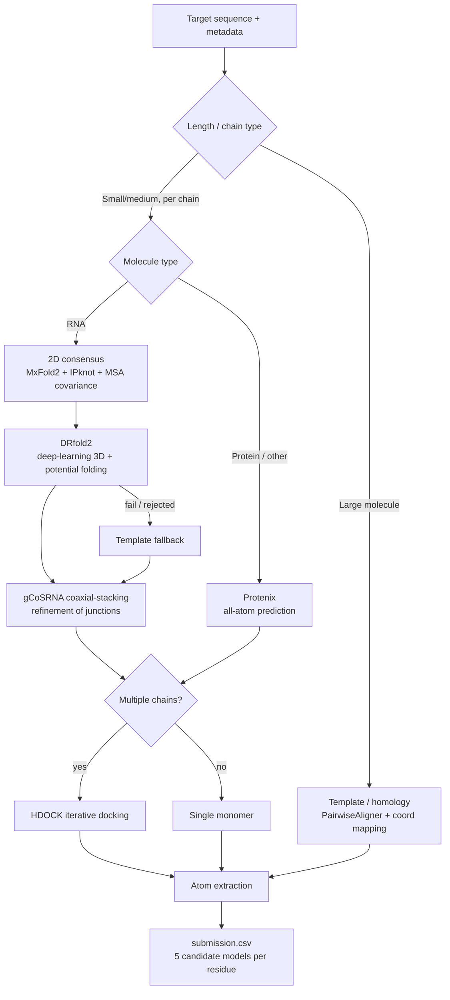

# RNA 3D Structure Prediction Pipeline

An end-to-end, **fully offline** pipeline for predicting the 3D structure of RNA (and RNA–protein) targets, built for the [Stanford RNA 3D Folding](https://www.kaggle.com/competitions/stanford-rna-3d-folding-2) Kaggle competition. The system ensembles classical thermodynamic folders, deep-learning structure predictors, evolutionary (MSA) signal, a coaxial-stacking refinement model, and rigid-body docking into a single submission generator — with every dependency installed from pre-uploaded datasets and several C/C++ tools compiled from source inside the notebook (no internet access at run time).

---

## Table of Contents

- [Why this is hard](#why-this-is-hard)
- [Pipeline at a glance](#pipeline-at-a-glance)
- [Stage-by-stage walkthrough](#stage-by-stage-walkthrough)
  - [1. Secondary structure (2D)](#1-secondary-structure-2d)
  - [2. Evolutionary signal & consensus](#2-evolutionary-signal--consensus)
  - [3. Tertiary structure (3D)](#3-tertiary-structure-3d)
  - [4. Coaxial-stacking refinement (gCoSRNA)](#4-coaxial-stacking-refinement-gcosrna)
  - [5. Complex assembly (HDOCK)](#5-complex-assembly-hdock)
  - [6. Template / homology fallback](#6-template--homology-fallback)
  - [7. Submission formatting](#7-submission-formatting)
- [Orchestration logic](#orchestration-logic)
- [Offline / Kaggle engineering notes](#offline--kaggle-engineering-notes)
- [Notable problems solved](#notable-problems-solved)
- [Known limitations](#known-limitations)
- [Components & credits](#components--credits)

---

## Why this is hard

Predicting RNA tertiary structure is an open problem: there is far less training data than for proteins, base-pairing is hierarchical (with pseudoknots and long-range tertiary contacts), and a single target may contain multiple chains of mixed molecule types. On top of the modelling difficulty, the competition environment is **air-gapped** — the notebook cannot reach PyPI, GitHub, or any model hub at run time, so the entire toolchain has to be reconstructed from offline assets.

This pipeline tackles both problems: a multi-tool **ensemble** for accuracy, and a carefully engineered **offline build/install layer** so the whole thing runs unattended on a Kaggle kernel.

---

## Pipeline at a glance

---

## Stage-by-stage walkthrough

### 1. Secondary structure (2D)

Two complementary folders are run on each RNA sequence and their predictions reconciled:

- **MxFold2** — a deep-learning + thermodynamic 2D folder. Installed offline from a local wheel via `poetry-core`/`poetry` and run on a pretrained model config (`TrainSetA`).
- **IPknot** — an integer-programming folder that, unlike most tools, can recover **pseudoknots**. There is no offline wheel, so it is **compiled from source inside the notebook**: a custom `CMakeLists.txt` is generated, the GLPK linear-programming backend and a ViennaRNA shared object are linked in (the ViennaRNA dev headers are unpacked from a `.deb`), and the binary is built with `cmake --build`.

A consensus dot-bracket is then formed position-by-position, agreeing where both tools agree and falling back to evolutionary signal where they disagree.

### 2. Evolutionary signal & consensus

For each target, a **multiple sequence alignment (MSA)** is read from the competition data (`Bio.AlignIO`) and a per-column **covariance / co-evolution signal** is computed. This signal is fused with the MxFold2/IPknot outputs in `get_consensus_ss()` to produce a single, more reliable consensus secondary structure that downstream 3D modelling and the coaxial-stacking step consume.

### 3. Tertiary structure (3D)

- **DRfold2 (primary RNA predictor).** A deep-learning end-to-end RNA structure predictor with a differentiable **potential-based folding** backend (`PotentialFold`): cubic-spline distance potentials, geometric operations, and L-BFGS / gradient optimization (`Optimization.py`, `Selection.py`, `Cubic.py`, `operations.py`). The repo and weights are staged into the writable working directory and inference scripts are written at run time, with the MSA and consensus 2D supplied as conditioning.
- **Protenix (non-RNA chains).** An AlphaFold3-style **all-atom** biomolecular structure predictor used for protein (and other non-RNA) chains. Weights are loaded once into GPU memory (`InferenceRunner`) and re-used across targets to amortize the load cost; biotite/rdkit handle the structure I/O.
- **Template fallback.** When DRfold2 fails or is rejected by constraint checks, prediction falls back to template-based modelling (below).

### 4. Coaxial-stacking refinement (gCoSRNA)

RNA multibranch junctions frequently feature **coaxial stacking**, where two helices stack end-to-end to form a quasi-continuous rod. **gCoSRNA** parses the consensus 2D into pseudo two-way junctions, computes thermodynamic/sequence features, and uses a trained scikit-learn model to predict which stems stack, resolving conflicts with a max-weight matching over the junction cycle.

The pipeline calls gCoSRNA **in-process** and maps each predicted stack back to **exact residue indices** for the two stems plus the junction pivot. A geometry routine then rotates the smaller (nested) helix arm about the junction so its axis becomes collinear with the reference helix — moving the entire subtended arm (not just the stem) to avoid tearing the backbone. The step is **gated, clash-guarded, and exception-wrapped** so it can never corrupt or crash a prediction, and can be toggled off for A/B evaluation.

### 5. Complex assembly (HDOCK)

For multi-chain targets, individual monomers are assembled by **iterative rigid-body docking** with HDOCK (`hdock` + `createpl`). Chains are docked pairwise into a growing complex, with strict absolute-path handling so per-target temporary files never collide.

### 6. Template / homology fallback

Large molecules (and any chain where the deep models fail) are handled by **homology modelling**: a global pairwise aligner (`Bio.Align.PairwiseAligner`) scores the target against a library of training sequences, and coordinates from the best-matching template are mapped onto the target with connectivity and length enforced.

### 7. Submission formatting

Predicted structures are parsed with `Bio.PDB`; the representative **C1′** atom (RNA) or **Cα** (protein) per residue is extracted and written into the competition CSV schema — `ID, resname, resid` plus `x_1…z_5`, i.e. **five candidate coordinate sets per residue**.

---

## Orchestration logic

The main loop (`run_main_loop`) drives everything per target:

1. **Branch by size** — large molecules go straight to template/homology modelling.
2. **Per-chain monomer prediction** — RNA chains → consensus 2D → DRfold2 (→ template fallback) → gCoSRNA refinement; non-RNA chains → Protenix.
3. **Assembly** — if a target has multiple chains, iteratively dock them with HDOCK.
4. **Extract & format** — pull representative atoms and append submission rows.
5. **GPU hygiene** — `torch.cuda.empty_cache()` between targets to survive long batched runs.

> Tinker (AMBER99 molecular-mechanics refinement) and SimRNA (coarse-grained Monte-Carlo relaxation) were integrated and compiled/staged, but are **disabled in the final pipeline** in favor of compatibility and runtime budget. The build code is retained for experimentation.

---

## Offline / Kaggle engineering notes

Everything runs with **no network access**:

- **Wheels, not `pip install`** — all Python packages (`biopython`, `biotite`, `rdkit`, `draw_rna`, ViennaRNA, MxFold2, …) install from pre-uploaded Kaggle datasets with `--no-index --find-links`.
- **Compiled from source in-notebook** — IPknot (CMake + GLPK + ViennaRNA) and Tinker (CMake + offline FFTW kit) are built at run time; system `.deb`s are installed with `dpkg -i` and shared libraries are exposed via `LD_LIBRARY_PATH` and symlinks.
- **Binaries staged to writable dirs** — read-only `/kaggle/input` assets (SimRNA, HDOCK, repos, weights) are copied into `/kaggle/working`, made executable, and repaired where needed.
- **Version pinning discipline** — the offline image fixes the whole scientific stack (NumPy/SciPy/sklearn/torch), so version conflicts are resolved without downgrading shared libraries (see below).

---

## Notable problems solved

- **scikit-learn cross-version pickle break.** gCoSRNA's model was pickled with scikit-learn 1.3.2 but the Kaggle image ships 1.6.1, where trees gained a `monotonic_cst` attribute — old pickles crash on `predict_proba`. Rather than downgrade sklearn (which drags NumPy/SciPy down and breaks DRfold2/Protenix/Torch/biotite/rdkit), a minimal **class-level compatibility shim** injects the missing default so the old model loads and predicts correctly under the modern stack.
- **Reverse-mapping ML predictions to atoms.** gCoSRNA's text output labels stems with junction-**local**, set-ordered indices that are ambiguous across multiple multibranch loops. The integration instead calls gCoSRNA's functions in-process and reads the real stem objects, giving unambiguous residue indices — validated against gCoSRNA's own matching on multiple junction topologies.
- **Headless, import-safe tool reuse.** gCoSRNA's module ran a plotting demo on import; an import-safe copy stubs the `draw_rna` dependency and strips the demo so its functions can be reused without a display or extra dependencies.
- **Geometry that respects topology.** Coaxial alignment rotates the entire nested arm about the junction (chosen as the smaller subtree) with a steric-clash guard, instead of rotating bare stem residues and shredding connectivity.

---

## Known limitations

- **Heuristic post-hoc refinement.** Rigidly re-orienting an arm of an already-predicted 3D model is a heuristic; it can introduce clashes and should be A/B tested against the leaderboard metric (hence the on/off toggle and clash guard). True coaxial-stacking enforcement belongs in the folding/refinement objective.
- **Threshold-driven routing.** Size thresholds choosing between deep models and templates are empirical and not individually tuned per target.
- **No final all-atom MM relaxation.** Tinker/SimRNA are wired but disabled; predictions are backbone-representative rather than energy-minimized all-atom.

---

## Components & credits

| Stage | Tool | Role |
|---|---|---|
| 2D | MxFold2 | Deep-learning + thermodynamic secondary structure |
| 2D | IPknot | Pseudoknot-aware secondary structure (IP/GLPK) |
| 2D | ViennaRNA | Energy model / shared library backend |
| Evolution | BioPython MSA + covariance | Co-evolution signal & consensus 2D |
| 3D (RNA) | DRfold2 | Deep-learning 3D + potential-based folding |
| 3D (other) | Protenix | AlphaFold3-style all-atom prediction |
| Refinement | gCoSRNA | Coaxial-stacking prediction & junction geometry |
| Assembly | HDOCK | Rigid-body docking of multi-chain complexes |
| Fallback | BioPython PairwiseAligner | Template / homology modelling |
| (disabled) | Tinker, SimRNA | MM refinement / coarse-grained relaxation |

All third-party tools are the property of their respective authors; this project integrates them into a single offline inference pipeline.
